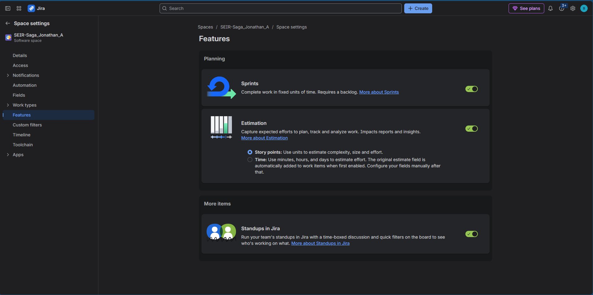
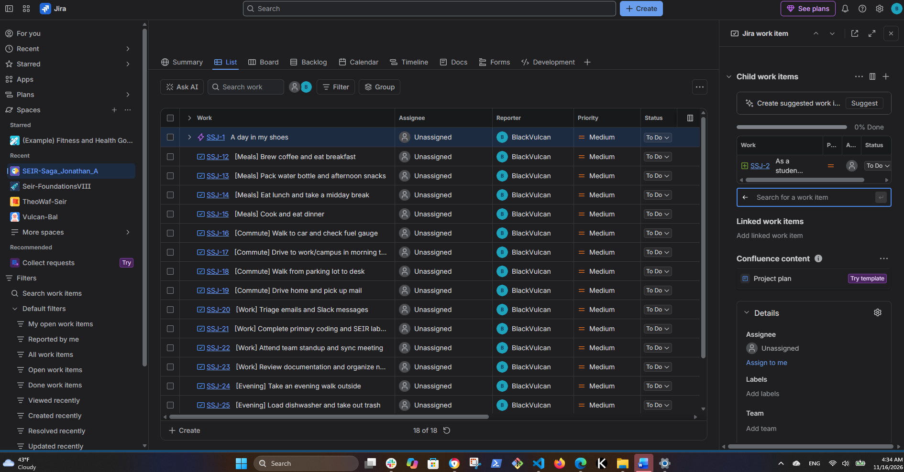
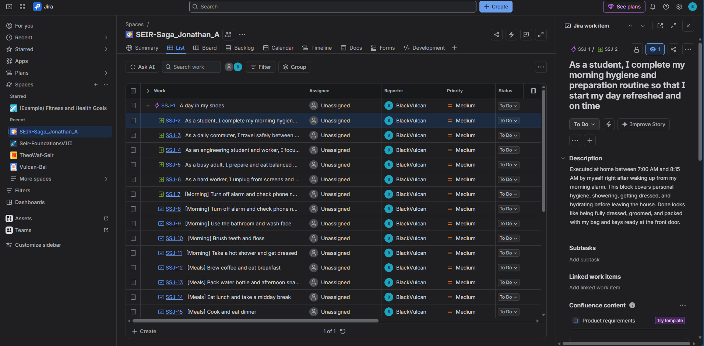
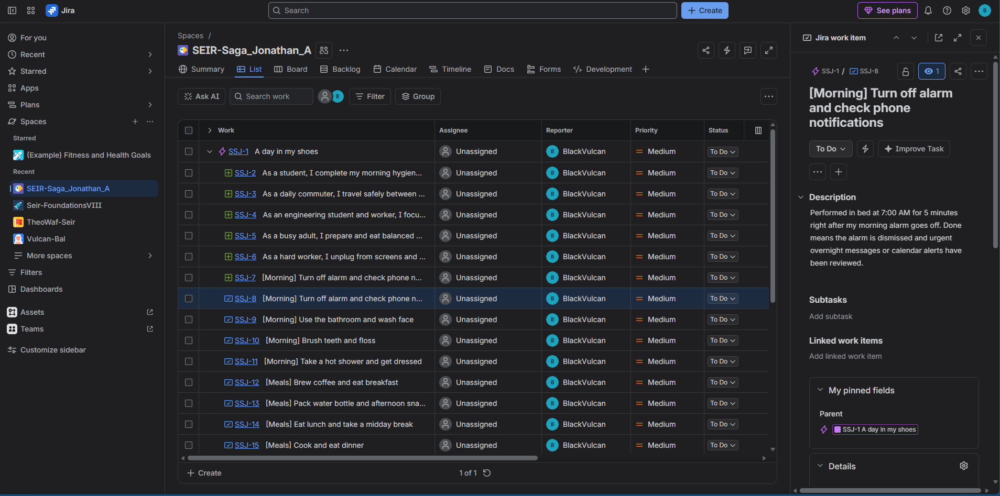
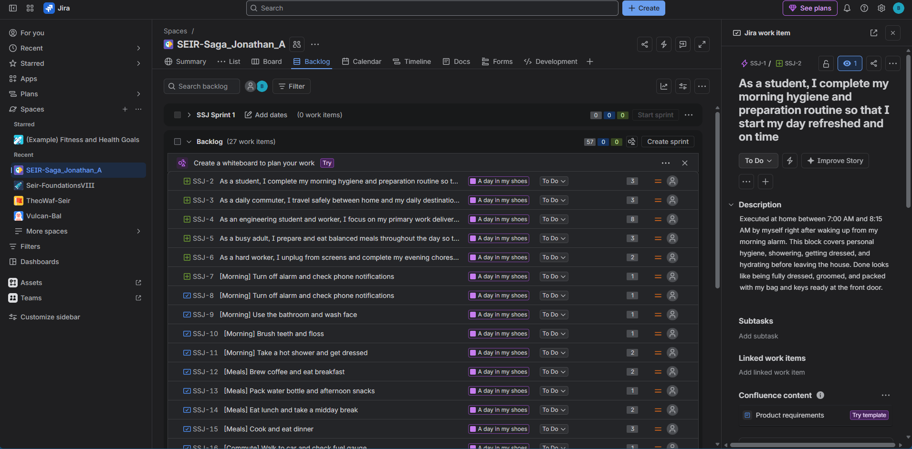

# Module 1, Lesson 3 — Jira Agile Workspace (`SEIR-Saga_Jonathan_A`)

- **Student:** Jonathan Austin
- **Space Name:** `SEIR-Saga_Jonathan_A`
- **Project Key:** `SSJ`
- **Epic:** `SSJ-1` — *A day in my shoes*
- **Total Story Points:** **60** (19 across Stories + 41 across Tasks)

---

## Evidence Table

| Jira Key | Work Type | Summary | Story Points |
| :--- | :--- | :--- | :---: |
| `SSJ-1` | Epic | A day in my shoes | — |
| `SSJ-2` | Story | As a student, I complete my morning hygiene and preparation routine so that I start my day refreshed and on time | 3 |
| `SSJ-3` | Story | As a daily commuter, I travel safely between home and my daily destinations so that I arrive on schedule without stress | 3 |
| `SSJ-4` | Story | As an engineering student and worker, I focus on my primary work deliverables and SEIR labs so that I stay on track with deadlines | 8 |
| `SSJ-5` | Story | As a busy adult, I prepare and eat balanced meals throughout the day so that I maintain steady energy and focus | 3 |
| `SSJ-6` | Story | As a hard worker, I unplug from screens and complete my evening chores so that I get a full night of restorative sleep | 2 |
| `SSJ-7` | Task | [Morning] Turn off alarm and check phone notifications | 1 |
| `SSJ-8` | Task | [Morning] Turn off alarm and check phone notifications | 1 |
| `SSJ-9` | Task | [Morning] Use the bathroom and wash face | 1 |
| `SSJ-10` | Task | [Morning] Brush teeth and floss | 1 |
| `SSJ-11` | Task | [Morning] Take a hot shower and get dressed | 2 |
| `SSJ-12` | Task | [Meals] Brew coffee and eat breakfast | 2 |
| `SSJ-13` | Task | [Meals] Pack water bottle and afternoon snacks | 1 |
| `SSJ-14` | Task | [Meals] Eat lunch and take a midday break | 2 |
| `SSJ-15` | Task | [Meals] Cook and eat dinner | 3 |
| `SSJ-16` | Task | [Commute] Walk to car and check fuel gauge | 1 |
| `SSJ-17` | Task | [Commute] Drive to work/campus in morning traffic | 3 |
| `SSJ-18` | Task | [Commute] Walk from parking lot to desk | 1 |
| `SSJ-19` | Task | [Commute] Drive home and pick up mail | 3 |
| `SSJ-20` | Task | [Work] Triage emails and Slack messages | 2 |
| `SSJ-21` | Task | [Work] Complete primary coding and SEIR lab assignment | 5 |
| `SSJ-22` | Task | [Work] Attend team standup and sync meeting | 2 |
| `SSJ-23` | Task | [Work] Review documentation and organize notes | 3 |
| `SSJ-24` | Task | [Evening] Take an evening walk outside | 2 |
| `SSJ-25` | Task | [Evening] Load dishwasher and take out trash | 2 |
| `SSJ-26` | Task | [Evening] Watch a show and scroll on phone | 1 |
| `SSJ-27` | Task | [Bedtime] Brush teeth, set alarm, and go to sleep | 1 |

---

## Biggest Task & Estimation Rationale

My biggest task is **`SSJ-21` (`[Work] Complete primary coding and SEIR lab assignment`)**, which I estimated at **5 Story Points** (the highest point value of any individual task in the backlog). Unlike routine 1- or 2-point habits such as brushing my teeth or triaging messages, completing a coding lab requires sustained deep focus, debugging unexpected edge cases, and verifying deliverables against technical requirements. Because of that higher cognitive complexity, time commitment, and risk of blockers, a 5-point estimate accurately reflects its relative effort compared to simpler daily tasks.

---

## Required Screenshots (`screenshots/`)

| File | Description | Preview |
| :--- | :--- | :--- |
| `jira_estimation_on.jpg` | Space settings showing Estimation enabled with Story points selected |  |
| `jira_epic.jpg` | `SSJ-1` (*A day in my shoes*) opened showing child Stories/Tasks and story point badges |  |
| `jira_story.jpg` | Detail view of a Story showing Parent (`SSJ-1`), 2+ sentence description, and Story point estimate |  |
| `jira_task.jpg` | Detail view of a Task showing Parent (`SSJ-1`), 2+ sentence description, and Story point estimate |  |
| `jira_backlog.jpg` | Backlog view displaying Stories and Tasks with their Story point estimates |  |
